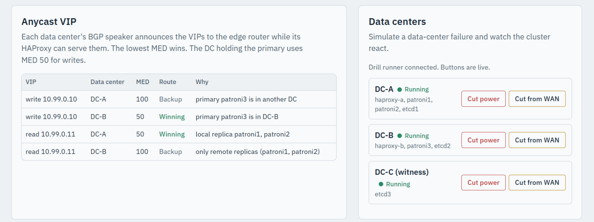

# PostgreSQL HA across three data centers

## Patroni + etcd + HAProxy + BGP anycast on Docker for Windows

A lab that simulates **three data centers** on one machine and keeps PostgreSQL available when
any one of them loses power or gets cut off from the network. Clients use **one address** that
follows the database across data centers, the way it would with BGP anycast in a real network.

It grew out of the single-data-center lab
([postgres-patroni-ha-lab](https://github.com/trilist1/postgres-patroni-ha-lab)) and keeps its
history, landing page and tooling.


*The management page at http://localhost:9090, live: which DC carries each VIP, the primary
and its replicas, BGP speakers, HAProxy routing and the etcd quorum. It redraws every 5 seconds,
so failovers and data-center failures play out on screen.*

| Component | Version |
|-----------|---------|
| PostgreSQL | 18.6 |
| Patroni | 4.1.5 |
| etcd | 3.7.2 |
| HAProxy | 3.4.6 |
| FRR (edge router) | 10.7.1 |
| ExaBGP (per-DC BGP speaker) | 5.0.14 |
| postgres_exporter / Prometheus / Grafana | 0.20.1 / 3.15.0 / 13.2.3 |

All images are pinned. Versions live in `SETTINGS` at the top of `lab.py`.

---

## Architecture

```
                       Windows host: localhost:6432 (write)  localhost:6433 (read)
                                              │
                                ┌─────────────┴──────────────┐
                                │ edge router  FRR, AS 65000 │   "the WAN / the internet"
                                │ write VIP 10.99.0.10/32    │   picks the lowest MED
                                │ read  VIP 10.99.0.11/32    │
                                └───────┬───────────┬────────┘
                                   BGP  │           │  BGP
 ┌─ DC-A  AS 65001 ─────────────────────┴─┐   ┌─────┴──────── DC-B  AS 65002 ─┐   ┌─ DC-C witness ─┐
 │  bgp-a  (ExaBGP, shares haproxy-a's    │   │  bgp-b                        │   │                │
 │          network namespace)            │   │                               │   │                │
 │  haproxy-a   :5000 :5001 :7000         │   │  haproxy-b   :5100 :5101 :7100│   │                │
 │                                        │   │                               │   │                │
 │  patroni1 (PostgreSQL)   patroni2      │   │  patroni3 (PostgreSQL)        │   │                │
 │  etcd1                                 │   │  etcd2                        │   │  etcd3         │
 └────────────────────────────────────────┘   └───────────────────────────────┘   └────────────────┘
                     each DC has its own Docker network; a shared "wan" network joins them
```

**Why a third, witness site?** etcd needs a majority (2 of 3) to elect a leader. With only two
sites, losing the site that holds two etcd members would stop automatic failover. The witness runs
only etcd3, so losing **any one** site leaves 2 of 3 members and failover stays automatic in every
direction.

### How the single IP works

1. Each DC runs a small **BGP speaker** (ExaBGP) next to its HAProxy. It checks that HAProxy every
   2 seconds and talks BGP to the edge router.
2. The **write VIP** `10.99.0.10` is announced while that HAProxy can reach the PostgreSQL primary,
   with **MED 50 if the primary is in this DC** and MED 100 otherwise.
3. The **read VIP** `10.99.0.11` is announced while that HAProxy can reach a replica, with MED 50
   when one of them is in this DC. If no replica is left anywhere, HAProxy falls back to the primary
   for reads, so reads keep working.
4. The **edge router** (FRR) compares MEDs across data centers (`bgp always-compare-med`) and
   installs the winner. Traffic from `localhost:6432` / `6433` is NATed to the VIP and follows that
   route to the winning DC's HAProxy.
5. When a DC dies or is cut off, its BGP session drops (9 s hold timer) or its speaker withdraws the
   route, and the edge router moves to the other DC.

Both HAProxies have the **same configuration** and always send writes to whichever node is primary,
in any DC. BGP only chooses which entry point clients use.

---

## What happens when a data center fails

Measured in this lab while a client wrote through `localhost:6432` once per second
(async replication, Patroni TTL 30 s, BGP hold time 9 s):

| Drill | What happens | Write outage | Reads (`:6433`) | Acknowledged writes lost |
|-------|--------------|--------------|-----------------|--------------------------|
| `lab dc-down a`, primary in DC-A (power cut) | DC-B promotes patroni3 after the leader lock expires; VIP moves to DC-B | about 25-38 s | continue until promotion | 0 |
| `lab dc-down a`, primary in DC-B | Nothing to fail over; reads fall back to the primary once DC-A's replicas are gone | **0 s** | 14 s blip | 0 |
| `lab dc-down b --graceful`, primary in DC-B | Patroni releases its lock on shutdown, so DC-A takes over quickly | about 10 s | continue | 0 |
| `lab partition b`, primary in DC-B | patroni3 can't reach etcd or its peers and **demotes itself** (no split-brain); DC-A promotes | about 28-32 s | continue | **1 of 117** |
| `lab dc-down c` (witness) | etcd keeps 2 of 3; nothing changes | 0 s | none | 0 |

The lost write in the partition drill is the trade-off of **asynchronous replication**: patroni3
confirmed one commit just before the partition that hadn't reached DC-A yet, and `pg_rewind`
discarded it when patroni3 rejoined. See [Zero data loss](#zero-data-loss-synchronous-replication)
to rule that out.

A split-brain check ran alongside the partition drill. At no point did two nodes accept writes,
and inside the partitioned DC patroni3 refused writes (`read-only transaction`) until it rejoined.

---

## Quick start

### Prerequisites

- Docker Desktop for Windows (WSL2 backend), 8 GB RAM for Docker
- Python 3.10+ on the host (`lab.py` uses only the standard library)
- Free host ports: 2379-2383, 3000, 5000-5001, 5100-5101, 5433-5435, 6432-6433, 7000, 7100, 8008-8010, 9090-9091, 9187-9189

### Setup

```cmd
git clone https://github.com/trilist1/postgres-patroni-multidc-lab.git
cd postgres-patroni-multidc-lab
lab setup
```

`lab setup` generates every config, builds the three local images (Patroni, BGP speaker, edge
router), starts the 17 containers, waits for a leader, and creates `pg_stat_statements`, the
`appuser` role and the `appdb` database. To load existing data at the same time:

```cmd
lab setup --restore path\to\pg_dumpall.sql
```

Then open **http://localhost:9090**.

The folder can live anywhere: `docker-compose.yml` only uses relative paths.

---

## Commands

`lab.cmd` runs `lab.py` with your Python. Run `lab` with no arguments for a menu.
In `cmd`, type `lab <command>` from the repo folder; in **PowerShell** type `.\lab <command>`
(PowerShell doesn't run scripts from the current folder without `.\`). Or call
`python lab.py <command>` directly on any OS.

| Command | What it does |
|---------|--------------|
| `lab setup [--restore FILE]` | Generate, build, start, post-setup, optional restore |
| `lab generate` | Rewrite `docker-compose.yml` and every config from `lab.py` |
| `lab build` | Build the Patroni, BGP speaker and edge router images |
| `lab up` / `lab stop` / `lab down` | Start, stop (keep containers), remove containers (data kept). Also start / stop the drill runner |
| `lab status` | Data-center state, `patronictl list`, BGP table |
| `lab bgp` | The edge router's sessions and both VIP routes |
| `lab dc-down <a\|b\|c> [--graceful]` | Power cut for a whole DC (SIGKILL). `--graceful` stops it cleanly |
| `lab dc-up <a\|b\|c>` | Power it back on. PostgreSQL nodes rejoin as replicas (with `pg_rewind` if needed) |
| `lab partition <a\|b\|c>` | Cut a DC off the WAN. Its containers keep running and still see each other |
| `lab heal <a\|b\|c>` | Reconnect it |
| `lab restore FILE` | Load a `pg_dumpall` file into the current primary |
| `lab drills [start\|stop\|status\|run]` | The background runner behind the landing page's data-center buttons (started by `lab up`, log in `state\drills-runner.log`) |
| `lab logs [service]` | Follow logs |
| `lab remove [--data]` | Remove containers and images (`--data` also deletes the data folders) |

Notes:
- `dc-down`, `dc-up`, `partition` and `heal` record what they did in `state/lab-state.json`,
  which the landing page reads to draw "Powered off" and "Cut off from the WAN" badges.
- Running `docker compose up -d` while a DC is partitioned reconnects it (Compose restores the
  declared networks). Use `lab heal` to be explicit.

---

## Ports

| Endpoint | Host port | Notes |
|----------|-----------|-------|
| **Write VIP** (BGP anycast) | **6432** | Always the primary, entering through the DC that wins the write VIP |
| **Read VIP** (BGP anycast) | **6433** | A replica (or the primary if no replica is left) |
| DC-A HAProxy write / read / stats | 5000 / 5001 / 7000 | Stats login `admin` / `HaproxyStats2026` |
| DC-B HAProxy write / read / stats | 5100 / 5101 / 7100 | Same config as DC-A |
| patroni1 / 2 / 3 PostgreSQL | 5433 / 5434 / 5435 | Direct, bypassing HAProxy |
| patroni1 / 2 / 3 REST API | 8008 / 8009 / 8010 | |
| etcd1 / 2 / 3 | 2379 / 2381 / 2383 | |
| pg-exporter1 / 2 / 3 | 9187 / 9188 / 9189 | |
| Landing page | **9090** | Bound to `127.0.0.1` only: it can trigger switchovers and DC failures |
| Prometheus | 9091 | 12 scrape targets incl. both HAProxies and the lab's `/metrics` |
| Grafana | 3000 | `admin` / `GrafanaAdmin2026` |

---

## Landing page

**http://localhost:9090** draws the whole setup and refreshes every 5 seconds:



- **Data center frames** with their AS numbers. Each PostgreSQL container shows PostgreSQL's own
  state (role, lag, connections, databases, size, uptime), with the Patroni agent as a row underneath
  and the exporter as a separate chip.
- **The edge router and both BGP speakers**: which DC carries the write VIP and the read VIP, and
  with what MED. The active path is drawn bold; the standby DC's paths are faint.
- **Failures**: a powered-off DC fades and gets a "Powered off" badge. A partitioned DC gets a red
  frame and a "Cut off from the WAN" badge, and the WAN links into it turn red.
- **Anycast VIP** panel: every BGP path for both VIPs, which one wins, and why each DC announces or
  withdraws.
- **Change leader**: planned switchover or emergency failover to any node, with confirmation. The
  write VIP follows the new primary to its DC within about 2 seconds.
- **Data centers**: buttons to **Cut power**, **Cut from WAN**, **Power on** and **Reconnect** each
  data center (see below).
- **View config** on any box: its compose definition, mounted files and running config (Patroni DCS
  config, Prometheus config, etcd members, the edge router's BGP table, a speaker's current decision).
  Passwords are masked unless you tick **Show secrets**.

### Simulating a data-center failure from the page

The **Data centers** panel has one row per DC with buttons for its current state:

| DC state | Buttons |
|----------|---------|
| Running | **Cut power** (SIGKILL every container, with an optional *graceful shutdown* tick box), **Cut from WAN** |
| Powered off | **Power on** |
| Cut off from the WAN | **Reconnect**, **Cut power** |

Each action asks for confirmation and says what will happen *right now*, for example "the primary
patroni1 is here, so writes stop for about 30 s until another DC is promoted", or "etcd keeps 2 of 3
members, so nothing should change" for the witness. It warns when another DC is already out, because
losing a second one leaves etcd without a quorum. After you confirm, the page shows the result and
the diagram, VIP panel and Grafana annotations follow the failover live.

**How it works.** The landing page container has no access to Docker: giving a web-facing
container the Docker socket would hand it control of your whole Docker host. Instead, a button
queues a request file in `state\requests\`, and the **drill runner**, a small loop in `lab.py`
running in the background on your machine with your Docker CLI, carries it out with exactly the same
code as `lab dc-down`, `lab dc-up`, `lab partition` and `lab heal`. It accepts only those actions,
for DC-A, DC-B or DC-C, and usually answers within a second.

The runner has no window. `lab up` and `lab setup` start it, `lab stop` and `lab down` stop it, and
it keeps running after you close the terminal. To manage it by hand:

```cmd
lab drills status     REM is it running, and is it busy?
lab drills start      REM start it in the background (no window)
lab drills stop       REM stop it
lab drills run        REM run it in this terminal instead, for debugging (Ctrl+C to stop)
```

Its output goes to `state\drills-runner.log`. While it isn't running, the buttons are disabled and
the panel says how to start it. The landing page is bound to `127.0.0.1:9090`, so only your own
machine can press them.

---

## Grafana dashboards

**http://localhost:3000** (`admin` / `GrafanaAdmin2026`) opens on **HA Overview**. All five dashboards
sit in the *PostgreSQL HA* folder and link to each other from the top bar:

| Dashboard | What it answers |
|-----------|-----------------|
| **HA Overview** (home) | Who is primary and in which DC, which DC carries the write and read VIPs, nodes/replicas/etcd/BGP sessions up, worst replica lag, failovers in the time range; timelines of DC state, VIP routing and PostgreSQL roles; TPS, connections, lag, HAProxy sessions |
| **PostgreSQL** | Per node and database (dropdowns): health, commits/rollbacks, rows written/read, connections by state, longest transaction, cache hit ratio, disk vs cache reads, temp files, I/O time, checkpoints (PG17+ checkpointer), buffers, WAL, locks, deadlocks, replica conflicts, database sizes, **top queries by time and by calls with their SQL** |
| **Replication & Failover** | Timeline, primary, failsafe mode, unlocked cluster, pending restart, pause; role and streaming timelines; lag in bytes and seconds; WAL positions; time since each node reached etcd; slot retention; BGP sessions, VIP announcements, winning DC and MEDs over time; write backend per DC |
| **etcd** | Members up, members that see a leader, Raft leader and its history, leader changes, proposals, WAL fsync / commit / peer round-trip p99, peer traffic, gRPC requests, DB size, send and heartbeat failures |
| **HAProxy** | Per DC (dropdown): backend and server health over time, active servers, health-check failures, sessions, session rate, bytes, connection errors, connect time, server state changes |

Every dashboard shows **annotations** for failovers or switchovers (a new timeline) and for
simulated data-center events (power and WAN changes), so you can line a drill up with its effect.

Metric sources: postgres_exporter (with `stat_checkpointer`, `stat_statements` and query text),
Patroni and etcd `/metrics`, **HAProxy's built-in exporter** (port 8404 in each DC, internal only),
and the landing page's **`/metrics`** (`lab_*` gauges: BGP sessions, VIP announcements and MEDs,
the winning DC, powered-off and partitioned DCs, and `lab_node_info` mapping every node to its DC).

The dashboards are generated by `grafana_dashboards.py` (called by `lab generate`) with the landing
page's colours. Edit that file, run `lab generate`, and Grafana reloads them automatically (it can't
see file changes through the Windows bind mount, so `lab` calls Grafana's reload API).

---

## Connecting with pgAdmin

`pgadmin-servers.json` holds nine ready-made entries in three groups:

| Group | Entries |
|-------|---------|
| pg-ha multi-DC | **VIP write :6432** and **VIP read :6433**: use these day to day |
| pg-ha multi-DC - HAProxy per DC | DC-A :5000 / :5001, DC-B :5100 / :5101 |
| pg-ha multi-DC - nodes | patroni1-3 direct, :5433-5435 |

All use user `postgres` (password `SuperSecret2026`) and `gssencmode=disable`.

**From the menu** (pgAdmin 9.18 on Windows): **Tools > Import/Export Servers...**, choose
**Import**, pick `pgadmin-servers.json`, select **Next**, keep all servers ticked, **Next**,
**Finish**. Then open a server, enter the password and tick **Save Password**.

**From the command line** (close pgAdmin first, run from the repo folder):

```cmd
set "PGA=%LOCALAPPDATA%\Programs\pgAdmin 4"
set "PATH=%PGA%\runtime;%PATH%"
"%PGA%\python\python.exe" "%PGA%\web\setup.py" load-servers pgadmin-servers.json --user pgadmin4@pgadmin.org
```

- `pgadmin4@pgadmin.org` is pgAdmin's built-in desktop-mode user; in server mode use your login email.
- Without the `runtime` folder on `PATH` it fails with `libpq library not found`.
- Running it twice creates duplicates. **Don't use `--replace`**: it deletes every server and group
  in your pgAdmin, not just these. Remove duplicates by hand.

**If pgAdmin crashes with `exception: access violation writing 0x0000000000000000`**: pgAdmin 9.x
on Windows can crash in its PostgreSQL client while probing for Kerberos (GSSAPI) encryption. The
imported entries avoid it with `gssencmode=disable`. For a server you add by hand, set
**Properties > Parameters > GSS encryption mode = disable**.

---

## Zero data loss (synchronous replication)

By default replication is **asynchronous**: commits are fast, but a power cut or partition can lose
the last moments of writes that hadn't reached another DC yet (the partition drill lost 1 of 117).
To make every commit wait until a replica has it:

```cmd
docker exec patroni1 patronictl -c /etc/patroni/patroni.yml edit-config -s synchronous_mode=true --force
```

Patroni then picks a synchronous standby and only fails over to it, so an acknowledged commit is
never lost. The price is one round trip to the standby on every commit; across real data centers
that is the WAN latency. `synchronous_mode_strict=true` goes further and stops writes entirely when
no standby is available. Turn it off again with `-s synchronous_mode=false`.

---

## Configuration

Everything is defined at the top of `lab.py`:

- `SETTINGS`: images and versions, credentials, the VIPs, MED values, ports, subnets
- `DCS`: which nodes live in which data center, AS numbers, HAProxy ports
- `NODE`: per-node host ports and WAN addresses

Change them and run `lab generate`, then `lab up`. Don't edit `docker-compose.yml` or `config\`
by hand: they are regenerated.

Patroni runs with `failsafe_mode: true`, so a primary stays up through a short etcd outage as long
as it can still reach every other Patroni node (a brief WAN blip). If it can't, it demotes itself,
which is what prevents split-brain in the partition drill.

**Credentials** are deliberately public lab defaults so the lab runs without setup:

| Service | User | Password |
|---------|------|----------|
| PostgreSQL superuser | `postgres` | `SuperSecret2026` |
| Replication | `replicator` | `ReplSecret2026` |
| Application | `appuser` (owns `appdb`) | `AppSecret2026` |
| HAProxy stats | `admin` | `HaproxyStats2026` |
| Grafana | `admin` | `GrafanaAdmin2026` |

Change them in `SETTINGS` before running anywhere shared.

---

## File structure

```
postgres-patroni-multidc-lab\        ← wherever you cloned it
├── lab.py                          ← generator + CLI (all settings live here)
├── lab.cmd                         ← Windows wrapper: lab <command>
├── docker-compose.yml              ← generated
├── pgadmin-servers.json            ← pgAdmin import file
├── grafana_dashboards.py           ← generates the five Grafana dashboards
├── patroni-image\                  ← Patroni + PostgreSQL 18 image
├── bgp\                            ← BGP speaker image: ExaBGP + health.py
├── edge\                           ← edge router image: FRR + NAT + status writer
├── landing\                        ← landing page (server.py, index.html)
├── docs\                           ← screenshots used in this README
├── config\                         ← generated configs (Patroni, HAProxy, FRR, Prometheus, Grafana)
├── certs\                          ← TLS material, generated, not in git
├── state\                          ← runtime state: lab-state.json, BGP status files (not in git)
└── pgdata\ etcd-data\ prometheus-data\ grafana-data\   ← data (not in git)
```

---

## Troubleshooting

| Symptom | Cause | Fix |
|---------|-------|-----|
| `localhost:6432` times out but `:5000` works | No DC is announcing the write VIP (no primary reachable) | `lab bgp`, `lab status`; check the landing page's Anycast VIP panel |
| `lab bgp` shows a session `Active` / `Connect` | That DC's speaker can't reach the edge (DC down or partitioned) | Expected during drills; otherwise `docker logs bgp-a` |
| A speaker shows "local HAProxy not answering" | HAProxy was restarted outside Compose (`docker restart haproxy-a`), leaving the speaker in a dead network namespace | Nothing: after ~20 s the speaker's watchdog restarts it inside HAProxy's new namespace. Or `docker restart bgp-a` |
| A dashboard change doesn't show up in Grafana | Grafana can't see file changes through the Windows bind mount | `lab generate` asks Grafana to reload; otherwise `docker restart grafana` |
| A node stays `stopped` after `lab dc-up` | It's waiting for an etcd member | Check `lab status`; it needs any healthy etcd member |
| Landing page shows a DC as "Powered off" but it's running | You started it with `docker start` instead of `lab dc-up` | Run `lab dc-up <dc>` to update `state/lab-state.json` |
| pgAdmin access violation | See [Connecting with pgAdmin](#connecting-with-pgadmin) | `gssencmode=disable` |
| Data center buttons are greyed out | The drill runner isn't running (e.g. after a reboot) | `lab up` or `lab drills start`; details in `state\drills-runner.log` |
| A button says "Another failure simulation is still queued" | A request is waiting in `state\requests\` (runner was stopped) | Start the runner, or delete the file |

---

## Limitations

This is a lab, not a production design:

- All "data centers" share one Docker host, so there is no real WAN latency or packet loss.
- The edge router is a single point of failure. In a real network you'd have several, plus real
  upstream routers.
- BGP sessions and Patroni's REST API are unauthenticated, and everything binds to your host's ports.
